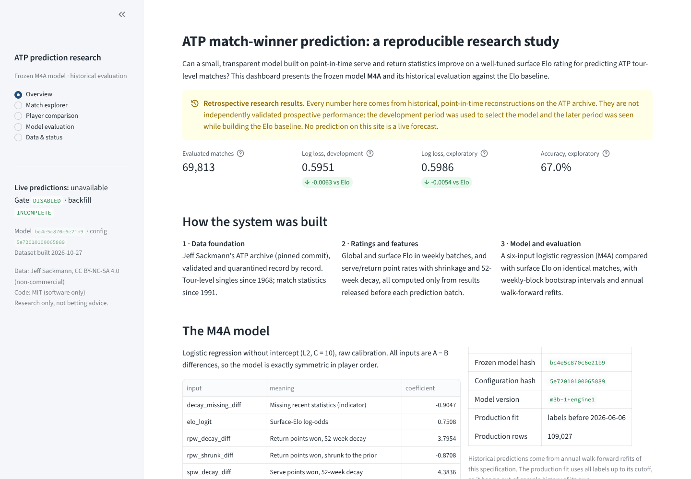
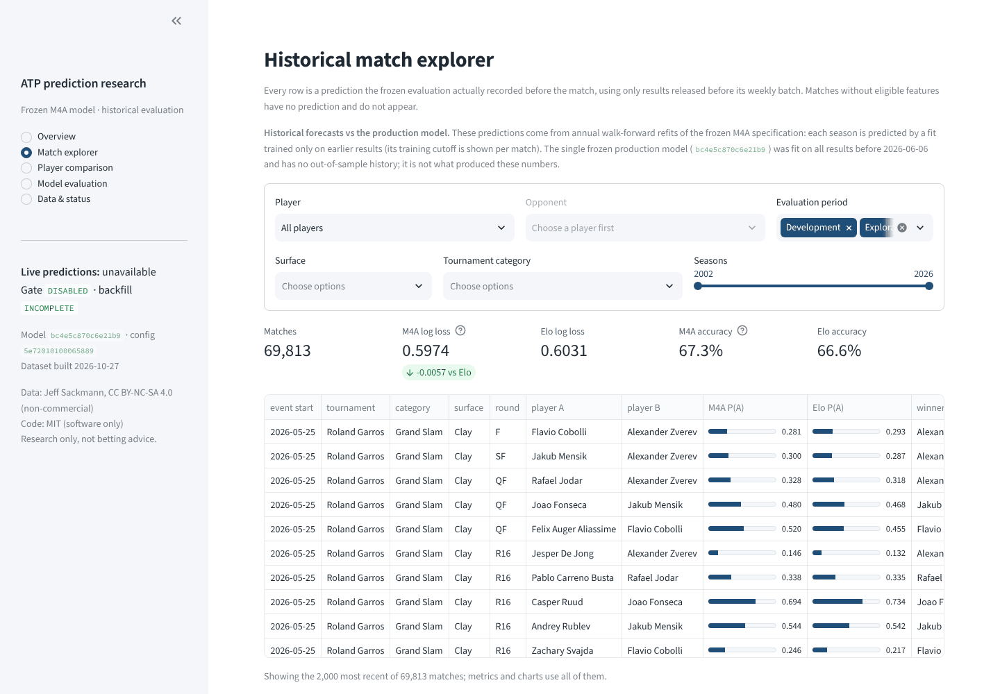
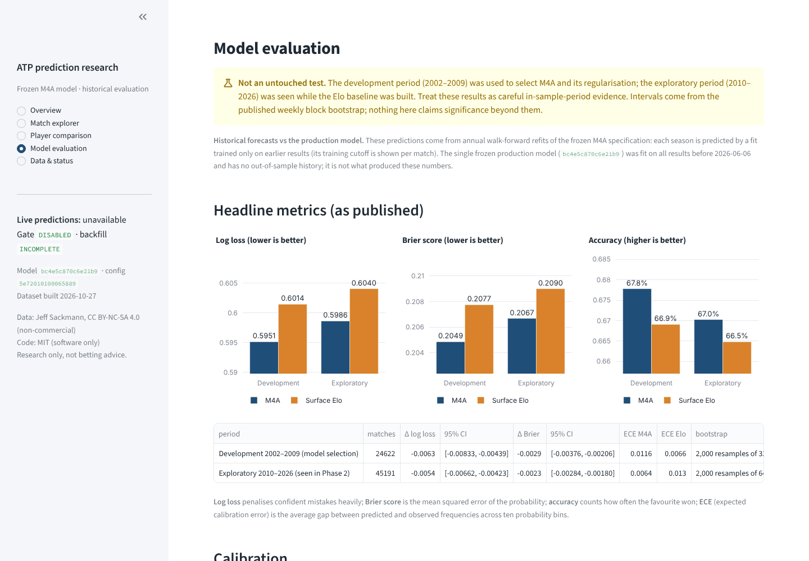
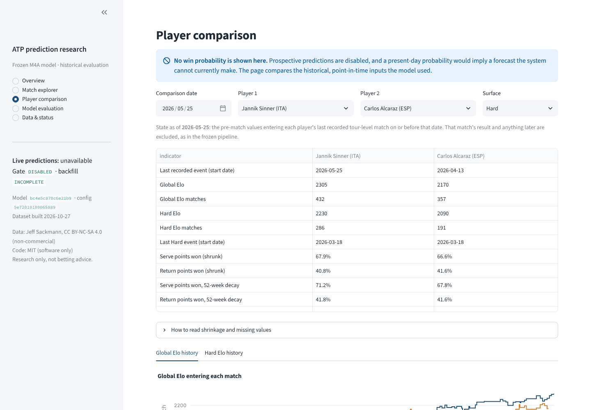
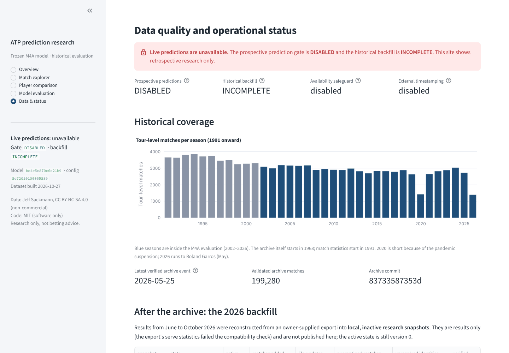
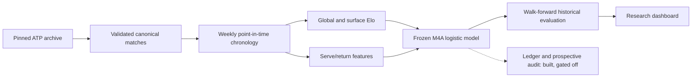

# ATP Tennis Prediction: A Reproducible Machine Learning Research System

[](https://github.com/vermillonn/tennis-prediction-data/actions/workflows/ci.yml)


This project predicts the winners of historical ATP tour-level singles matches. It asks whether point-in-time serve
and return statistics add information to a well-tuned surface Elo rating, and answers with a frozen, six-input
logistic regression (**M4A**) evaluated against Elo with walk-forward refits and block-bootstrap uncertainty.

The research sits on a reproducible data system. It covers:

- a validated match table built from a pinned, checksummed archive;
- chronology-aware rating and feature engines;
- an append-only prediction ledger;
- a read-only audit framework;
- an interactive research dashboard.

Everything is deterministic and tested (532 automated tests).

> **Scope.** This is retrospective research, not a live forecasting or betting service.
> - Prospective predictions are **disabled**.
> - The post-archive backfill is **incomplete**.
> - No independently verified prospective performance exists yet.



## Research questions

1. Can historical serving and returning performance improve match-winner prediction beyond surface Elo?
2. How large is the improvement under historical walk-forward evaluation?
3. How do performance and calibration vary by surface, tournament type and player experience?
4. What limits an assessment of tennis predictions when the historical record has no match-level timestamps?

## Key findings

M4A against the surface-Elo baseline on identical matches. Lower log loss and Brier score are better. Δ = M4A − Elo.

| period | role | matches | log loss M4A | log loss Elo | Δ log loss (95% CI) | Brier M4A | Brier Elo | accuracy M4A | accuracy Elo |
|---|---|---|---|---|---|---|---|---|---|
| 2002–2009 | development (model selection) | 24,622 | 0.59512 | 0.60142 | −0.00630 [−0.00833, −0.00439] | 0.20486 | 0.20775 | 67.8% | 66.9% |
| 2010–2026 | exploratory (seen in Phase 2) | 45,191 | 0.59861 | 0.60403 | −0.00541 [−0.00662, −0.00423] | 0.20668 | 0.20899 | 67.0% | 66.5% |

Intervals come from a paired bootstrap that resamples whole weekly batches: 2,000 resamples over 322 and 645 weeks.
The Δ is computed before rounding.

What the evidence supports:

- **A consistent but small improvement.** M4A beats surface Elo in all four exploratory sub-periods.
  - The reduction is about 0.9% of Elo's log loss in the exploratory period.
  - Accuracy rises by about half a percentage point.
  - Elo remains the dominant input: serve/return features without Elo are clearly worse than Elo alone (+0.033).
- **Recency, not career averages.** In development, career-long shrunk serve/return rates do not improve on
  Elo. The 52-week decay-weighted rates and a missing-history indicator carry the gain.
- **A large part is a cold-start correction.** Matches where a player has fewer than 1,000 released service
  points account for:
  - 81% of the log-loss reduction in development;
  - 54% of the reduction in the exploratory period.

  Between established players the gain is smaller: −0.00303 [−0.00375, −0.00234] in the exploratory period.
- **Not uniform.** The gain is clearest on hard courts. On clay and at Grand Slams the interval includes zero, and
  the Grand Slam point estimate is slightly worse than Elo (+0.00168).

> **How to read these numbers.** Neither period is an untouched holdout.
> - The 2002–2009 period selected the model.
> - The 2010–2026 period was examined while the Elo baseline was built.
>
> The results are careful in-sample-period evidence of an improvement over Elo, not proof of out-of-sample
> generalisation. A pre-specified prospective protocol exists, but has not been run.

Full analysis: [docs/research_summary.md](docs/research_summary.md). The detailed reports are
[development](reports/modeling/development_report.md), [exploratory](reports/modeling/exploratory_report.md),
[calibration](reports/modeling/calibration_report.md) and [ablations](reports/modeling/ablation_report.md). The
model card is [reports/modeling/model_card.md](reports/modeling/model_card.md).

## Research dashboard

A five-section Streamlit application presents the frozen model and its evaluation from a public, archive-derived
dataset:

| section | what it shows |
|---|---|
| **Overview** | the question, method, M4A inputs and coefficients, model hashes and headline metrics |
| **Match explorer** | 69,813 recorded historical predictions with the paired Elo probability, filters and a per-match inspector |
| **Player comparison** | point-in-time Elo and serve/return indicators for two players as of any date (no win probability) |
| **Model evaluation** | published metrics with bootstrap intervals, reliability diagrams, subgroup differences |
| **Data & status** | live operational gates, historical coverage, aggregate backfill counts, data freshness |

| | |
|---|---|
|  |  |
|  |  |

The screenshots come from the real application running from a clean clone. More screenshots, including a mobile
view, are in [docs/assets/screenshots/](docs/assets/screenshots/). The source is in
[dashboard/](dashboard/streamlit_app.py), and the guide is [docs/dashboard.md](docs/dashboard.md). The app is
**not deployed**: it runs locally, and is ready for Streamlit Community Cloud at the owner's discretion.

## Methodology



1. **Data foundation.** Jeff Sackmann's ATP archive, fetched at one pinned commit with SHA-256 checksums.
   - 199,389 source rows become 199,280 validated matches and 109 quarantined rows. Every row is accounted for.
   - Player order is derived from a hash of the match ID, never from the result.
2. **Chronology.** The archive has tournament start dates but no match dates.
   - The model uses deterministic, frozen, batch-level information rules. Matches are grouped into weekly
     batches, and each prediction uses the state frozen at the start of its batch.
   - A result enters the state when its nominal release batch closes: one week for most events, two for Grand Slams,
     96+-draw Masters and the Olympics. Under this chronology, no feature includes its own target match.
   - This mitigates temporal leakage but does **not** prove match-level information availability. Some events
     overrun their nominal release batch, and the stronger prospective availability safeguard
     (`state_availability_v1`) remains disabled. See **Limitations**.
3. **Elo baseline.** Global and surface-specific Elo, tuned on 1991–2009:
   - global: K = 24;
   - surface: K = 32, with shrinkage toward global Elo (m = 40).
4. **Serve/return features.** 193,634 point-in-time rows, with:
   - career rates with beta-binomial shrinkage, and 52-week decay-weighted rates;
   - surface blends and opponent-adjusted strengths;
   - effective sample sizes.

   An allowlist guard keeps outcome and audit columns out of model inputs.
5. **Model.** An L2 logistic regression with no intercept, on antisymmetric A − B inputs. This makes it exactly
   symmetric in player order.
   - Six candidate models (among 14 registered experiments) were compared under a selection rule fixed before
     results: the simplest model within 0.0005 of the best development log loss. That rule chose M4A over the
     marginally better seven-input M4B.
   - The specification was frozen before any 2010–2026 row was scored: hash `bc4e5c870c6e21b9`, configuration
     `5e72010100065889`.
6. **Evaluation.** Annual walk-forward refits: each season is predicted by coefficients trained only on earlier
   released results.
   - These historical refits are what the dashboard and the reports evaluate.
   - The single **production fit** (trained on all labels before 2026-06-06) has no out-of-sample history.
7. **Operational and audit infrastructure** (Phases 4–5A). Implemented and tested, but gated off:
   - provider adapters and state reconstruction;
   - a hash-chained SQLite prediction ledger;
   - a read-only prospective evaluator with external timestamp anchoring;
   - a controlled historical backfill.

The architecture diagram and component map are in [docs/architecture.md](docs/architecture.md).

## Technologies

| area | tools |
|---|---|
| language and data | Python 3.11+, Polars, NumPy, Parquet (zstd), DuckDB views |
| modelling | NumPy implementations of L2 logistic regression (damped Newton), Elo, beta-binomial shrinkage and block bootstrap. No ML framework: every estimator is explicit and unit-tested, and SciPy is used only to cross-check optimisers in tests |
| storage and audit | SQLite (append-only, hash-chained ledger), SHA-256 content addressing, TOML configuration with configuration hashes |
| presentation | Streamlit, Plotly |
| engineering | uv (locked dependencies), pytest (532 tests), Ruff, GitHub Actions CI |

## Quick start

These commands work from a clean public clone, with no private data and no data download:

```bash
git clone https://github.com/vermillonn/tennis-prediction-data.git
cd tennis-prediction-data
uv sync --group dashboard                         # Python 3.11+, dependencies pinned in uv.lock
uv run streamlit run dashboard/streamlit_app.py   # open http://localhost:8501
uv run pytest                                     # 532 tests, synthetic fixtures, no network
```

To install without uv: `pip install -r dashboard/requirements.txt` runs the dashboard only.

Rebuilding the research outputs from source downloads the public archive (about 200,000 matches) and takes
minutes per phase:

```bash
uv run tennis-data run              # Phase 1: ingest the pinned archive, validate, report
uv run tennis-data elo-backtest     # Phase 2: Elo tuning and evaluation
uv run tennis-data features-build   # Phase 3A: point-in-time serve/return features
uv run tennis-data model-backtest   # Phase 3B: development, selection, freeze, walk-forward evaluation
```

[docs/reproducibility.md](docs/reproducibility.md) covers:

- what a public clone can verify;
- what a full rebuild requires;
- dataset-hash checks;
- the per-phase commands, including the operational phases.

## Limitations

- **Retrospective, non-pristine evaluation.**
  - The development period selected the model.
  - The exploratory period was seen while building the Elo baseline.
  - No independent holdout exists, and no prospective performance has been measured.
- **No match-level timestamps.** The archive records tournament start dates only.
  - Chronology is weekly, and the dates shown are event start dates.
  - Within-event order is approximate.
- **Batch-level, not match-level, information availability.** Results enter the state when their nominal release
  batch closes.
  - The Phase 5A chronology audit found events whose last matches were played on or after the day their results
    enter the state ([audit](reports/operations/backfill_authorization_owner-2026-10-26.md)). Examples are
    two-week events finishing a few days after release, and events that start mid-week or run longer than their
    nominal weeks.
  - For such events, a late-round result can be treated as available before it was actually known.
  - The frozen chronology is deterministic, and it excludes each target match from its own features. It does not
    prove that every result was known before every prediction.
  - The stronger safeguard `state_availability_v1` was proposed for prospective use only, and remains disabled.
    Historical results were not recomputed under it.
- **No post-hoc calibration.** M4A uses `raw` probabilities: temperature scaling was within the selection
  tolerance and the simpler method won.
  - Calibration is reasonable: exploratory ECE is 0.0064, against 0.0130 for Elo.
  - Development ECE is 0.0116, against 0.0066 for Elo.
- **Uneven gains.** Grand Slams (best-of-five) are slightly worse than Elo, and clay is inconclusive. The model has
  no format-specific term.
- **Feature coverage.** Serve statistics start in 1991 and are missing for some matches and events.
  - An owner-supplied 2025–2026 export failed the statistical compatibility check, so it adds results only.
- **The backfill does not establish live readiness.**
  - The backfill is INCOMPLETE and prospective predictions are DISABLED.
  - Historical state version 0 is active. The backfilled versions 1 and 2 are local and inactive.
  - External checkpoint publication is disabled.
- **Bootstrap intervals** resample weeks and ignore dependence through players shared across weeks, so they may be
  too narrow.

## Repository guide

| path | content |
|---|---|
| `src/tennis_data/` | the package: `ingestion`, `normalization`, `validation`, `storage`, `elo`, `features`, `modeling`, `prospective`, `ledger`, `evaluation_prospective`, `operations`, `dashboard` |
| `config/` | one TOML file per phase; every run records a configuration hash |
| `reports/` | committed, deterministic reports and tables (aggregate statistics only) |
| `dashboard/` | Streamlit app and its public dataset `dashboard/data/` (with a data card and SHA-256 manifest) |
| `docs/` | methodology per phase, [research summary](docs/research_summary.md), [reproducibility](docs/reproducibility.md), [architecture](docs/architecture.md), [portfolio summary](docs/portfolio_summary.md) |
| `tests/` | pytest suite on synthetic fixtures |

Methodology by phase:

- [data pipeline and schema](docs/source_schema.md), and the [data dictionary](docs/data_dictionary.md)
- [Elo](docs/elo.md)
- [features](docs/features.md)
- [modelling](docs/modeling.md)
- [current data and inference](docs/prospective_data.md)
- [ledger](docs/ledger.md)
- [prospective evaluation](docs/prospective_evaluation.md)
- [operational data](docs/operational_data.md)
- [dashboard](docs/dashboard.md)
- [experimental single-match predictions](docs/experimental_predictions.md) (personal research; labelled
  EXPERIMENTAL, never a prospective forecast)

## Licensing and attribution

- **Original software** (code, tests, documentation) is released under the [MIT License](LICENSE). It covers the
  software only, and grants no rights over the data.
- **Data** is compiled by **Jeff Sackmann** ([tennis_atp](https://github.com/JeffSackmann/tennis_atp)) and
  licensed under **CC BY-NC-SA 4.0**.
  - The license covers everything derived from the data: the committed reports and the dashboard dataset
    `dashboard/data/`.
  - Use is **non-commercial only**, adaptations must be shared alike, and Jeff Sackmann must be credited.
  - See [LICENSE-DATA.md](LICENSE-DATA.md) and the [dashboard data card](dashboard/data/README.md).
- **Owner-supplied sources** (the TennisMyLife exports used in Phase 5A) are not redistributed. Neither is
  anything derived from them at record level, nor any identity approval or local snapshot. Public reports about
  them contain aggregate counts only.

Nothing in this repository is betting advice.
