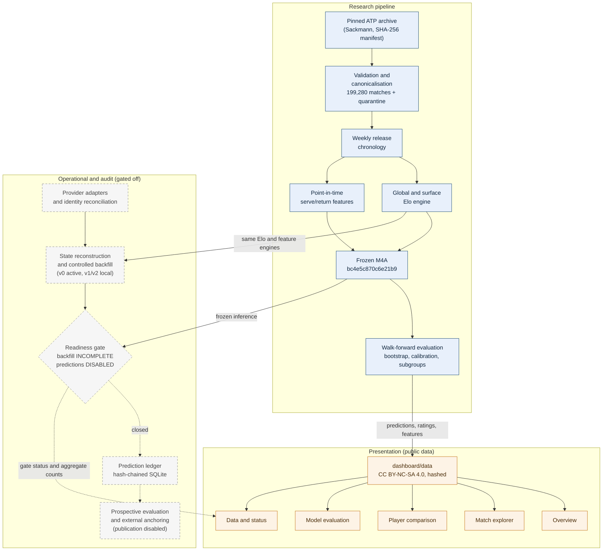

# Architecture

The system has three layers.

- **The research pipeline produced every published result.**
- **The operational and audit pipeline is implemented and tested, but gated off.** No prospective forecast has been
  made.
- **The presentation layer reads only public, archive-derived outputs.**

Blue boxes produced published results. Grey dashed boxes are implemented and tested but inactive for prospective
use. Orange boxes are the public presentation layer.

## Components

| layer | component | code | config | documentation |
|---|---|---|---|---|
| research | ingestion, normalisation, validation, storage | `src/tennis_data/{ingestion,normalization,validation,storage}` | `config/default.toml` | [source schema](source_schema.md), [data dictionary](data_dictionary.md) |
| research | Elo engine and backtest | `src/tennis_data/elo` | `config/elo.toml` | [elo.md](elo.md) |
| research | serve/return features | `src/tennis_data/features` | `config/features.toml` | [features.md](features.md), [feature dictionary](feature_dictionary.md) |
| research | modelling, selection, freeze, evaluation | `src/tennis_data/modeling` | `config/modeling.toml` | [modeling.md](modeling.md), [model card](../reports/modeling/model_card.md) |
| operational | providers, identity, reconciliation, backfill, inference | `src/tennis_data/prospective` | `config/prospective.toml` | [prospective_data.md](prospective_data.md) |
| operational | prediction ledger | `src/tennis_data/ledger` | `config/ledger.toml` | [ledger.md](ledger.md), [threat model](ledger_threat_model.md) |
| operational | prospective evaluation and anchoring | `src/tennis_data/evaluation_prospective` | `config/evaluation.toml` | [prospective_evaluation.md](prospective_evaluation.md) |
| operational | data readiness, controlled backfill, snapshots | `src/tennis_data/operations` | `config/operations.toml`, `config/availability.toml` | [operational_data.md](operational_data.md) |
| presentation | dashboard dataset builder and loaders | `src/tennis_data/dashboard` | none | [dashboard.md](dashboard.md), [data card](../dashboard/data/README.md) |
| presentation | Streamlit application | `dashboard/` | `.streamlit/config.toml` | [dashboard.md](dashboard.md) |

## Design principles

- **Deterministic batch-level chronology.**
  - Each component reads state frozen at the start of a weekly batch.
  - Results enter the state only when their nominal release batch closes, so no feature includes its own target
    match.
  - Model matrices pass an allowlist that rejects outcome and audit columns.
  - This mitigates temporal leakage, but it is not proof of match-level availability: some events overrun their
    release batch (Phase 5A audit). The prospective safeguard `state_availability_v1` stays disabled.
- **Determinism and provenance.** Inputs and outputs carry SHA-256 hashes, and configurations carry configuration
  hashes. Rebuilds are byte-identical, and the frozen model is verified by hash before use.
- **Gates live in configuration, not code paths.**
  - `config/prospective.toml` holds `backfill = "INCOMPLETE"` and `prospective_predictions = "DISABLED"`.
  - `config/availability.toml` keeps `state_availability_v1` disabled.
  - `config/evaluation.toml` keeps the external publication backends disabled.
  - The dashboard reads these files live.
- **Public and private separation.** `data/` is git-ignored. Record-level outputs derived from owner-supplied sources
  stay local, and only aggregate reports and the archive-derived `dashboard/data/` are committed.
